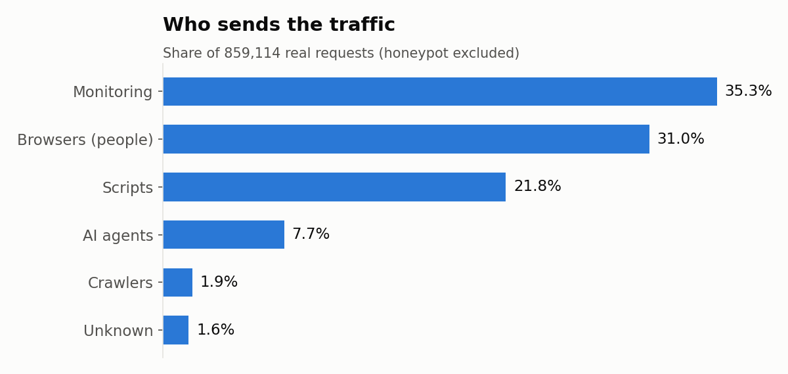
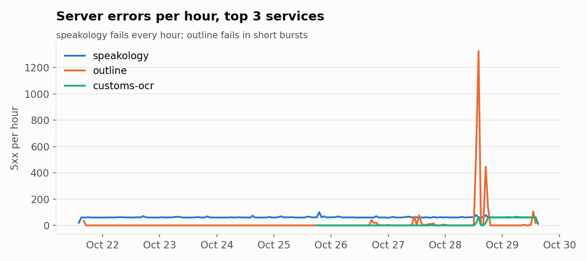
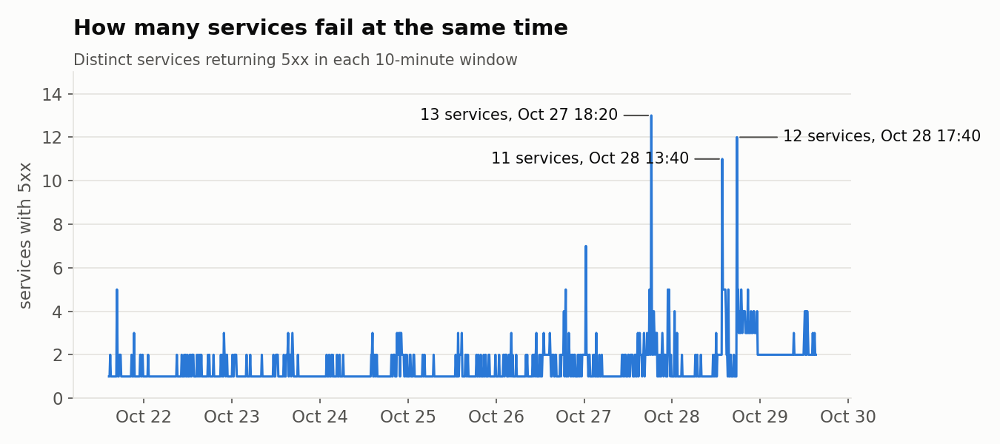
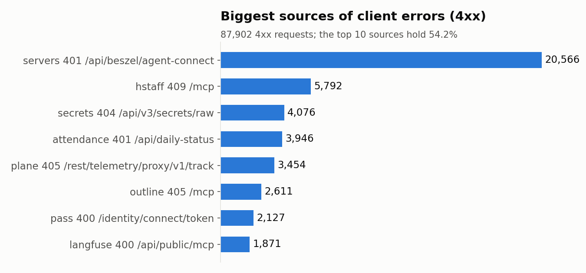

# Nginx Logs Report

One week of nginx access and error logs for humblebee.ai and hbai.dev,
2026-10-21 14:38 to 2026-10-29 15:13 (Asia/Seoul).
Details and code: notebooks `01` to `04` in this repository.

## Summary

- **Most server errors are not attacks or bugs.** They come from three services that were down the whole week and from shared outages that hit up to 13 services at once.
- **Machines send most of the traffic.** Real people (browsers) are 31% of requests.
- **No sign of a security incident.** Scanners are normal internet noise, and most of them hit the honeypot.
- **The logging itself needs fixing.** The JSON log skips static files, and the logs stored API keys.

## 1. Data

| | |
|---|---|
| Requests analysed | 1,187,827 (humblebee.ai, hbai.dev) |
| Real traffic (honeypot excluded) | 859,114 |
| All 10 domains with logs | 1,394,278, zero parse errors |

- **The JSON log is incomplete.** 32,299 requests exist only in the text log, and 99.3% of them are static files. The same gap appears on every domain with JSON logs, so it is a server-wide nginx setting: most likely a `location` block for static files with its own `access_log` line.
- **The logs stored secrets.** The `$remote_user` field held Langfuse API keys and an admin email. The column was dropped from the analysis.

## 2. Traffic

- **Machines dominate:** monitoring 35.3%, scripts 21.8%, AI agents 7.7%. Browsers are 31.0%.
- **The top IP is the Uptime-Kuma monitor,** with 242,445 requests.
- **The honeypot** (`a-honeypot`) received 328,713 requests, 90.8% of them from crawlers. It is excluded from all traffic and error numbers.
- **Location** comes from Cloudflare headers. Gaps were filled from the same IP. 28,039 rows from 4,213 IPs that never passed through Cloudflare stay unknown.
- **Top countries:** KR 469,997, UZ 82,653, IN 68,466, US 21,479.

## 3. Server errors (5xx)

19,891 server errors: 502 x 18,599, 500 x 1,040, 504 x 250, 503 x 2.
502 dominates, which means nginx could not reach the app: the app was not running.

**Services down the whole week**

| Service | Errors | Evidence |
|---|---|---|
| speakology | 11,874 x 502 | errors in 194 hours, the whole log period |
| smart-office | 630 | 100% of its requests fail |
| repo-holmes | 284 | 99.6% fail. Its traffic is GitHub webhooks, so webhook deliveries are lost |

97% of speakology's requests come from Uptime-Kuma, so the monitor saw the outage all week, but nobody acted on it. smart-office is called mostly by browsers, so real people got the errors.

**Shared outages**

| When | Services failing in the same 10 minutes | Type |
|---|---|---|
| Oct 27 18:20 | 13 | mostly 504: upstreams too slow |
| Oct 28 13:40 | 11 | 502. outline alone: 1,645 x 502 in one hour |
| Oct 28 17:40 | 12 | 502 |

Separate apps do not fail in the same minutes by chance. Something they share (the host, the proxy or the network) failed. Host logs are needed to confirm what.

**Single-app incidents**

- **jnj, Oct 26 04:10:** 559 x 500 in 20 minutes. The app answered with errors, so this is a bug or crash inside jnj.
- **hstaff `/mcp`:** the nginx error log has 352 errors, all to one upstream host (100.100.1.30). 319 go to port 21840, which serves `/mcp`. Types: 122 refused, 107 connect timeouts, 78 read timeouts, 34 premature close. The service restarts or goes down (refused), and long MCP streams are cut by nginx's read timeout.
- **nginx reloads are not a cause:** errors in the 30 minutes before and after each reload are about equal (29 vs 34, 34 vs 36).

## 4. Client errors (4xx)

87,902 requests (10.2% of real traffic) got a 4xx. The top 10 sources hold 54.2% of them. Most are our own clients, misconfigured and retrying the same failing call:

- **Beszel agent:** 20,566 x 401 on `/api/beszel/agent-connect`, a wrong or expired key. 19,554 come from one internal machine.
- **`/mcp` endpoints** (hstaff, outline, langfuse, dex): 13,433 x 400, 405 or 409 from AI agent clients. Part of this is normal MCP handshake (405 on GET); the 400 and 409 are worth checking.
- **secrets:** 4,076 x 404 from a single Python script asking for a secret that does not exist.
- **attendance:** 3,946 x 401 from 9 clients, browser tabs polling with an expired login.
- **pass:** 2,127 x 400 on `/identity/connect/token` from 106 clients, failed token requests on the password manager.

## 5. Security

- **Scanners:** 122 IPs sent at least 10 probes each (`/.env`, `/.git`, `/wp-admin`, ...), 18,520 requests in total. 96.5% of all probes hit the honeypot.
- **No evidence of a leak.** 104 probes on real services got a 200, but many different secret paths returned the same response size: a catch-all page, not the real files.
- **One path to check by hand:** `/admin/config.php` on humblebee.ai returned 200 once with 0 bytes.
- **The `servers` login takes 15 s every time,** but it is not brute force: 22 requests, all internal, 16 successful.

## 6. Recommendations

In priority order:

1. **Rotate the Langfuse API keys** that were written to the logs, and stop logging credentials.
2. **Restart or remove speakology, smart-office and repo-holmes.** Re-deliver the lost GitHub webhooks to repo-holmes.
3. **Route uptime alerts to a person.** The monitor saw the outages for a week.
4. **Investigate the Oct 27 and Oct 28 shared outages** with host and proxy logs.
5. **hstaff `/mcp`:** check the upstream on port 21840 and raise `proxy_read_timeout` for long MCP streams.
6. **Fix the misconfigured clients:** the Beszel agent key, the secrets script, and the attendance polling.
7. **Fix the nginx static-file `location`** so the JSON log records every request.
8. **Check `/admin/config.php`** and the failed token requests on `pass`.

## 7. Method and limits

- **Method:** JSON and text access logs merged on `request_id`, cleaned with pandas, saved to Parquet. Clients labelled by ordered user-agent rules, IPs classified with `ipaddress` (Tailscale `100.64.0.0/10` counted as internal). Errors analysed by service, by hour and in 10-minute windows. The error logs were parsed with a regex.
- **Limits:**
  - Causes are inferred from the access and error logs only. Confirming the shared outages needs host logs.
  - User-agent labels can be faked. Scanners were found by behaviour instead.
  - 28,039 rows have no location.
  - The raw logs and Parquet files are not in this repository, because they contain visitor IPs. Public IPs in notebook outputs are masked.
